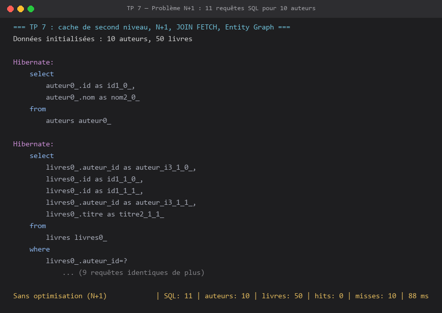

# TP 7 — Cache de second niveau, problème N+1, JOIN FETCH et Entity Graph

Projet Maven complet correspondant au lab **« TP 7 : Activation du cache de second niveau, optimisation des performances et suppression du problème N+1 avec JOIN FETCH et Entity Graph »** (Hibernate & JPA).

## Prérequis

- JDK 8+
- Maven 3.6+
- Aucun serveur de base de données : H2 en mémoire (`jdbc:h2:mem:test`)
- Aucun serveur de cache : EhCache 3 démarre en JVM (JCache / JSR-107)

## Structure

```
src/main/java/com/example
├── model/Auteur.java                      # @Cache(READ_WRITE) + @NamedEntityGraph + collection cachée
├── model/Livre.java                       # @Cache(READ_WRITE) + @ManyToOne(LAZY)
├── service/DataInitService.java           # jeu de données : 10 auteurs × 5 livres
├── service/PerformanceTestService.java    # N+1, JOIN FETCH, Entity Graph, cache L2, statistiques
├── service/Mesure.java                    # résultat d'une mesure (SQL, entités, hits, misses, durée)
└── App.java                               # exécution des 4 scénarios + récapitulatif
src/main/resources/META-INF/persistence.xml   # unité hibernate-cache-pu (cache L2 + statistiques)
src/main/resources/ehcache.xml                # configuration EhCache 3 des régions
pom.xml
```

## Exécution

```bash
mvn clean compile
mvn exec:java -Dexec.mainClass=com.example.App
```

> Sous **PowerShell**, les propriétés `-D...` doivent être entre guillemets :
> `mvn exec:java "-Dexec.mainClass=com.example.App"`

## Résultat attendu




## Point clé : le problème N+1

```java
List<Auteur> auteurs = em.createQuery("SELECT a FROM Auteur a", Auteur.class).getResultList();
for (Auteur auteur : auteurs) {
    livres += auteur.getLivres().size();   // 1 requête SQL par auteur
}
```

1 requête pour les auteurs + N requêtes pour les collections `LAZY` = **N+1 requêtes**
(ici 11 requêtes pour 10 auteurs).

## Solutions de chargement

| Approche | Code | Requêtes SQL |
|---|---|---|
| N+1 (naïf) | `SELECT a FROM Auteur a` + accès à `getLivres()` | 1 + N |
| `JOIN FETCH` | `SELECT DISTINCT a FROM Auteur a JOIN FETCH a.livres` | 1 |
| Entity Graph | `setHint("javax.persistence.fetchgraph", graph)` | 1 |

`DISTINCT` est indispensable avec `JOIN FETCH` sur une collection : sans lui, un auteur
apparaît autant de fois qu'il a de livres.

L'Entity Graph a l'avantage de garder la requête JPQL inchangée : le chargement est décrit
de façon déclarative sur l'entité, et peut être activé ou non selon le cas d'usage.

## Cache de second niveau

- `hibernate.cache.use_second_level_cache=true`
- `hibernate.cache.region.factory_class=org.hibernate.cache.jcache.JCacheRegionFactory`
- `hibernate.javax.cache.provider=org.ehcache.jsr107.EhcacheCachingProvider`
- `hibernate.javax.cache.uri=ehcache.xml`
- `@Cache(usage = CacheConcurrencyStrategy.READ_WRITE)` sur les entités **et** sur la collection

La première lecture d'un auteur absente du cache génère le SQL de chargement (miss),
la seconde lecture dans une nouvelle session ne produit **aucune** requête (hit) :
les entités sont servies depuis EhCache 3.

## Bonnes pratiques

- Activer `hibernate.generate_statistics` uniquement en développement/test (coût non nul).
- Toujours résoudre le N+1 par `JOIN FETCH` ou un Entity Graph avant d'ajouter du cache.
- `READ_WRITE` par défaut ; `READ_ONLY` pour des données de référence immuables, `NONSTRICT_READ_WRITE` si les collisions concurrentes sont acceptables.
- Éviter de mettre en cache les collections trop volumineuses ou modifiées en permanence.
- `hibernate.cache.use_structured_entries` simplifie le débogage mais ajoute du coût : à désactiver en production.
